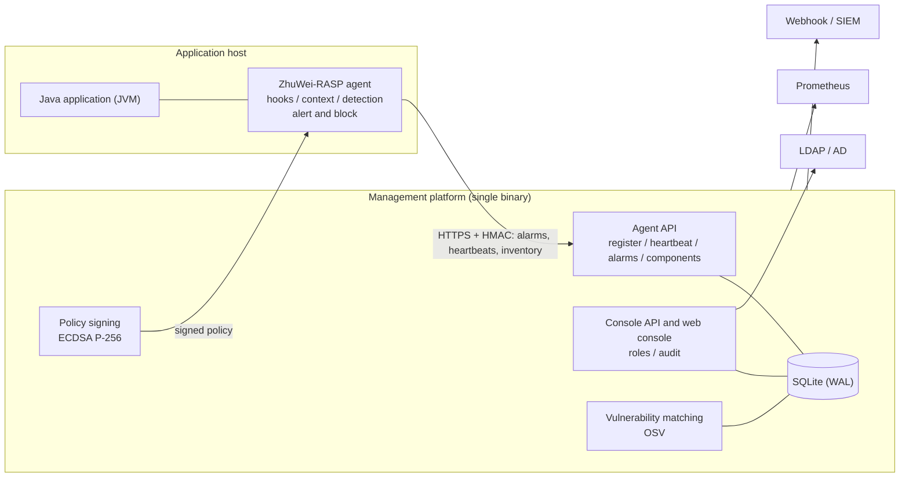

# ZhuWei-RASP

[简体中文](README.md) | **English** | [日本語](README.ja.md)

A Runtime Application Self-Protection (RASP) platform consisting of a Java agent, a management platform and a set of design documents.

| Item | Details |
|---|---|
| Current version | v0.1.0 (MVP) |
| Components | Java agent (JDK 8+), management platform (single Go binary with web console), design documents (13 chapters, in Chinese) |
| Intended use | Proof of concept and internal pilots; the platform itself is ready for production deployment |
| Prerequisite for go-live | Attack-specific detection algorithms (see "Project status") |

---

## Contents

1. [Overview](#overview)
2. [Project status](#project-status)
3. [Capabilities](#capabilities)
4. [Architecture](#architecture)
5. [Requirements](#requirements)
6. [Quick start](#quick-start)
7. [Production deployment](#production-deployment)
8. [Repository layout](#repository-layout)
9. [Development and testing](#development-and-testing)
10. [Documentation](#documentation)
11. [Roadmap](#roadmap)
12. [Known limitations](#known-limitations)
13. [Security notes](#security-notes)
14. [License](#license)

---

## Overview

A WAF sits in front of an application and judges attacks from HTTP traffic. RASP runs inside the application process (injected into the JVM as a Java agent) and inspects sensitive operations - SQL execution, process creation, file access, outbound requests, deserialization, JNDI lookups - right before they execute. It determines whether their arguments are controlled by user input and then alerts or blocks according to policy.

Because RASP sees the full execution context, it produces fewer false positives and is unaffected by traffic encoding or encryption. Because it shares the process with the business application, this project treats "the agent must never affect the application" as its highest-priority design constraint.

## Project status

| Area | Status |
|---|---|
| Management platform | Ready for production deployment: multiple users and roles, LDAP/AD login, auditing, policy signing, rate limiting, health checks and metrics, online backup, vulnerability matching and a deployment kit are implemented and tested |
| Java agent | Suitable for monitor-mode pilots: injection, hooks, request context, circuit breaker, policy verification, install/uninstall are verified; compatibility with JDK 8/11/17/21 is verified in CI |
| Detection | A generic rule engine ("user input reaches a sensitive operation") is provided. Attack-specific detection algorithms must be implemented by the security team through the `Detector` interface; this is required before enabling block mode |
| Console | Existing pages are functional; user management, API tokens and the vulnerability list are currently available through the API only |

Recommended path to production:

1. The security team implements the detection algorithms and evaluates them against an attack test set (chapters 5 and 10).
2. Pilot on non-critical applications in monitor mode for at least two weeks to assess false positives and performance impact.
3. Enable blocking application by application following the staged rollout procedure (chapter 8).
4. Complete every item of the [go-live checklist](docs/13-上线检查清单.md).

## Capabilities

### Java agent

- **Deployment**: `-javaagent` start-up option, or dynamic attach/detach to a running JVM without restart.
- **Isolation**: bootstrap stub classes, a dedicated class loader and relocated dependencies (shaded ASM); no conflicts with application libraries.
- **Hooks**: servlet entry (javax and jakarta), JDBC (any driver, matched by interface), process creation, file read/write, URL connections, deserialization, JNDI lookup.
- **Request context**: passive request-body capture (JSON, form, multipart; sensitive fields masked); the context follows work into thread pools, ForkJoinPool (parallel streams, CompletableFuture) and newly created threads.
- **Stability**: exception isolation on every path, re-entrance guard, circuit breaker on latency and error rate, emergency `DISABLE` file, bounded queues.
- **Component inventory**: identifies loaded third-party jars (including Spring Boot nested jars) with version and SHA-1, reported on change.

### Management platform

- Full lifecycle management of applications, instances, alarms, policies and allowlists; off, monitor and block modes.
- **Policy signing**: delivered configuration is signed with ECDSA P-256 and verified by agents against a pinned public key, with application binding, rollback protection and key rotation.
- **Block confirmation**: when a policy change would start blocking, the operator must type the application name to confirm; the change is audited.
- **Component vulnerability matching**: offline import of OSV data (including the GitHub Advisory Database), Maven version semantics, severity and fixed versions per finding, webhook alerts for new high/critical findings.
- **Alarm handling**: triage status, one-click allowlisting, full-text search, CSV export, webhook notifications (WeCom, DingTalk, SIEM).

### Security and compliance

- Three roles (viewer, operator, admin) enforced on every API; write operations require at least operator by default.
- PBKDF2-SHA256 password hashing; sessions and API tokens stored as hashes only; login lockout per IP and per user name.
- Optional LDAP / Active Directory login with group-to-role mapping; local accounts take precedence.
- HMAC-signed, replay-protected agent communication; every administrative action is audited.

### Operations

- Health checks (`/healthz`, `/readyz`) and Prometheus metrics on a separate internal listener.
- Per-application alarm rate limiting, online backup (including the signing key), start-up security checks.
- Install, upgrade and uninstall scripts, systemd units, Dockerfile, GitHub Actions CI.

## Architecture



If the platform is unreachable, agents keep running on their cached policy and write alarms to a local log; the application is not affected.

## Requirements

| Purpose | Requirement |
|---|---|
| Protected applications | JDK 8 or later; on JDK 21+ dynamic attach prints a JEP 451 notice, so `-javaagent` is recommended in production |
| Building the agent | JDK 17+, Maven 3.9+ |
| Building the platform | Go 1.27+, Node.js 22.12+ (only to build the console) |
| Running the platform | One binary and one data directory; no database server or Node.js required |

## Quick start

The following steps set up an evaluation environment. See the next section for production.

**1. Build**

```bash
./deploy/build.sh
```

Output in `dist/`: `dist/rasp/` (agent installation directory) and `dist/rasp-server` (management platform).

**2. Start the platform**

```bash
RASP_ADMIN_PASSWORD='<at least 12 characters>' ./dist/rasp-server -listen :8480 -db rasp.db -agent-url http://<platform-host>:8480
```

The first start creates the `admin` account and generates the policy signing key `rasp-sign.key` next to the database. Back it up.

**3. Connect an application**

1. Sign in to `http://<platform-host>:8480` and create an application under "Applications".
2. Save the generated configuration as `dist/rasp/conf/rasp.properties` and deploy `dist/rasp` to `/opt/rasp` on the application host.
3. Add `-javaagent:/opt/rasp/rasp-launcher.jar` to the Java start-up options. New applications start in monitor mode.

**Other options**

| Scenario | Method |
|---|---|
| Connect without restart | `/opt/rasp/tools/rasp-attach.sh attach <pid> --app <name>`; remove with `detach <pid>` |
| Standalone (no platform) | Leave `server.url` empty; the policy is read from `conf/policy.json` and alarms go to `logs/alarm.log` |
| Emergency stop | Turn on the global kill switch in the console, or create the file `/opt/rasp/DISABLE` on the host |

## Production deployment

| Topic | Guidance |
|---|---|
| Deployment | systemd: `deploy/server/` (hardened unit and a daily backup timer); containers: `server/Dockerfile` (non-root, distroless) |
| Transport security | Use `-tls-cert` / `-tls-key` or a TLS-terminating proxy; agents connect over `https://` |
| Accounts | Individual accounts for every user, or LDAP / AD; integrations use API tokens |
| Agent installation | `tools/install.sh --properties <file> --app-user <user>`, with upgrade and rollback support |
| Backup | `rasp-server backup -with-key <file>`, safe while the service is running |
| Monitoring | `RASP_OPS_LISTEN=127.0.0.1:9480` exposes `/metrics`; suggested alert rules are in chapter 13 |
| Vulnerability data | Run `rasp-server import-osv` regularly, or configure `-osv-url` for automatic updates |

The complete checklist, monitoring recommendations and measured capacity are in the [go-live checklist](docs/13-上线检查清单.md) (Chinese).

## Repository layout

```
agent-java/                 Maven multi-module build (agent compiled to Java 8 bytecode)
  rasp-launcher/            -javaagent entry point, class-loader isolation, attach tool
  rasp-bootstrap/           stub classes injected into the bootstrap class loader
  rasp-core/                hooks, bytecode weaving, context, rule engine, policy, breaker, reporting, inventory
  demo-app/                 Tomcat 10 demo application (isolated test environments only)
  compat-app/               Java 8 / Tomcat 9 compatibility test application and smoke test
server/                     Go management platform
  cmd/rasp-server/          main program and CLI (user / backup / import-osv)
  internal/                 agentapi, console, store, vuln, ldapauth, signing, ops, ...
  web/                      Vue 3 + TypeScript console, embedded into the binary
deploy/                     build script, agent configuration templates, install scripts, systemd units
docs/                       design documents, chapters 1-13 (Chinese)
.github/workflows/          CI: agent, JDK compatibility matrix, platform, browser tests, image build
```

## Development and testing

```bash
(cd agent-java && mvn -B clean package)        # agent build and unit tests
(cd server/web && npm ci && npm run build)     # console type check and build
(cd server && go vet ./... && go test ./...)   # platform tests
(cd server/web && npm run test:e2e)            # browser end-to-end tests (starts an isolated platform)
./deploy/build.sh                              # full build, assembles dist/
```

Conventions:

- The default policy is maintained only in `deploy/agent-conf/policy.json`; the build copies it into the platform.
- When the agent-platform protocol changes, update chapter 7 and keep old and new versions compatible in both directions.
- Console design system and internationalisation are described in [server/web/README.md](server/web/README.md).

## Documentation

The design documents in `docs/` are written in Chinese. Start with chapter 1 for concepts, then chapters 3 and 4 for the architecture. They describe the target design; where they differ from the current implementation, this file is authoritative.

| Chapter | Topic | Audience |
|---|---|---|
| [1 RASP overview](docs/01-RASP概述.md) | Concepts, principles, comparison with WAF / IAST, existing solutions | Everyone |
| [2 Requirements and scope](docs/02-需求与范围.md) | Goals, functional and non-functional requirements | Product, architecture |
| [3 Architecture](docs/03-总体架构.md) | Components, modules, technology choices | Architecture, development |
| [4 Agent design](docs/04-Agent设计-Java.md) | Injection, bytecode weaving, isolation, hooks, context | Agent developers |
| [5 Detection engine and rules](docs/05-检测引擎与规则.md) | Detection algorithms and rules (to be completed by the security team) | Security research |
| [6 Management platform](docs/06-管理平台-Server.md) | Services, data model, permissions, APIs | Platform developers |
| [7 Protocol](docs/07-通信协议与数据模型.md) | Agent-platform protocol and message formats | All developers |
| [8 Deployment and operations](docs/08-部署与运维.md) | Installation, upgrades, rollout, backup, key management | Operations |
| [9 Performance and self-protection](docs/09-性能稳定性与自身安全.md) | Performance budget, circuit breaking, self-protection | All developers |
| [10 Test plan](docs/10-测试方案.md) | Unit, compatibility, attack and performance tests | QA |
| [11 Development plan](docs/11-开发计划与里程碑.md) | Phases, staffing, risks | Management |
| [12 References](docs/12-参考资料.md) | Open-source projects and standards | Everyone |
| [13 Go-live checklist](docs/13-上线检查清单.md) | Prerequisites, deployment checks, monitoring, capacity, limitations | Operations, owners |

## Roadmap

| Priority | Item |
|---|---|
| P0 | Attack-specific detection algorithms; monitor-mode pilots and false-positive tuning |
| P1 | OIDC single sign-on; console pages for user management, API tokens and vulnerabilities |
| P2 | Memory-resident webshell detection; automated onboarding for WebLogic, WebSphere and similar servers |
| P3 | Scaled deployment on ClickHouse / Kafka; agents for other languages |

## Known limitations

- Detection relies on generic rules only; no attack-specific algorithms yet.
- Single-instance platform backed by SQLite; beyond tens of millions of alarms per day, migrate to the scaled architecture described in chapters 3 and 6.
- Vulnerability matching covers only components with a known groupId and version.
- Request bodies are captured only when the application reads them; Thread subclasses that override `run()` and virtual threads do not inherit the request context.
- Alarm keyword searches of one or two characters fall back to a full table scan.

## Security notes

- `demo-app` and `compat-app` contain intentionally unsafe endpoints and must only run in isolated test environments.
- Never commit the policy signing key `rasp-sign.key`, database files or `dist/` (all are listed in `.gitignore`).
- Report security issues in this project privately to the project owner through internal channels; do not disclose details in public issues.

## License

This repository does not currently declare a license. The project owner must choose an appropriate license before any external release or open-sourcing.
