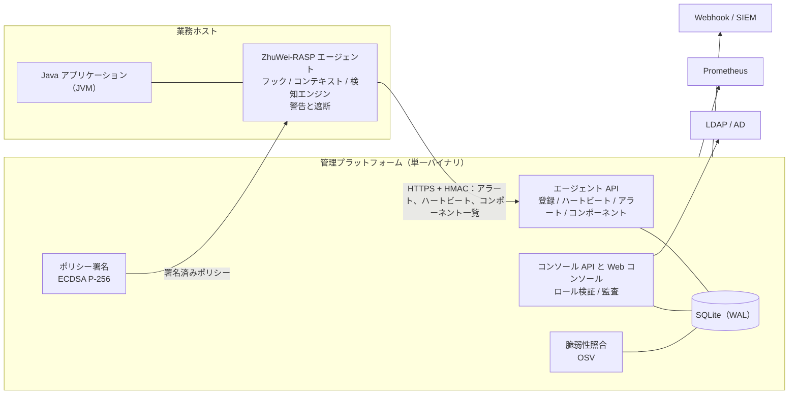

# ZhuWei-RASP

[简体中文](README.md) | [English](README.en.md) | **日本語**

Java エージェント、管理プラットフォーム、設計ドキュメントで構成される RASP（Runtime Application Self-Protection、実行時アプリケーション自己防御）プラットフォームです。

| 項目 | 内容 |
|---|---|
| 現在のバージョン | v0.1.0（MVP） |
| 構成 | Java エージェント（JDK 8 以降）、管理プラットフォーム（Go 単一バイナリ + Web コンソール）、設計ドキュメント（全 13 章、中国語） |
| 想定する利用段階 | 概念実証および社内パイロット。プラットフォーム部分は本番環境への導入が可能です |
| 本番稼働の前提条件 | 攻撃種別ごとの専用検知アルゴリズム（「プロジェクトの状況」を参照） |

---

## 目次

1. [概要](#概要)
2. [プロジェクトの状況](#プロジェクトの状況)
3. [主な機能](#主な機能)
4. [アーキテクチャ](#アーキテクチャ)
5. [動作要件](#動作要件)
6. [クイックスタート](#クイックスタート)
7. [本番環境への導入](#本番環境への導入)
8. [リポジトリ構成](#リポジトリ構成)
9. [開発とテスト](#開発とテスト)
10. [ドキュメント](#ドキュメント)
11. [ロードマップ](#ロードマップ)
12. [既知の制約](#既知の制約)
13. [セキュリティに関する注意](#セキュリティに関する注意)
14. [ライセンス](#ライセンス)

---

## 概要

WAF はアプリケーションの外側に配置され、HTTP トラフィックから攻撃を判断します。RASP はアプリケーションのプロセス内（Java エージェントとして JVM に組み込まれます）で動作し、SQL 実行、プロセス生成、ファイルアクセス、外部への通信、デシリアライズ、JNDI ルックアップといった重要な操作が実行される直前に、その引数がユーザー入力によって制御されていないかを検査し、ポリシーに従って警告または遮断を行います。

実行時のコンテキスト全体を把握できるため、誤検知が少なく、通信の符号化や暗号化の影響も受けません。一方で業務アプリケーションと同じプロセスで動作するため、本プロジェクトでは「エージェントが業務に影響を与えないこと」を最優先の設計原則としています。

## プロジェクトの状況

| 範囲 | 状況 |
|---|---|
| 管理プラットフォーム | 本番環境への導入が可能です。複数ユーザーとロール、LDAP/AD ログイン、監査、ポリシー署名、レート制限、ヘルスチェックとメトリクス、オンラインバックアップ、脆弱性照合、デプロイ一式を実装し、テスト済みです |
| Java エージェント | 監視モードでのパイロットに適しています。組み込み、フック、リクエストコンテキスト、サーキットブレーカー、ポリシー検証、インストールとアンインストールを検証済みです。JDK 8/11/17/21 との互換性は CI で検証しています |
| 検知機能 | 汎用ルールエンジン（「ユーザー入力が重要な操作に到達したか」）のみを提供しています。攻撃種別ごとの専用検知アルゴリズムは、セキュリティチームが `Detector` インターフェースを通じて実装する必要があり、遮断モードを有効にする前の必須作業です |
| コンソール | 既存の画面は利用可能です。ユーザー管理、API トークン、脆弱性一覧は現時点では API のみで提供しています |

本番稼働までの推奨手順は次のとおりです。

1. セキュリティチームが専用検知アルゴリズムを実装し、攻撃テストセットで評価します（第 5 章、第 10 章）。
2. 重要度の低いアプリケーションで、監視モードによるパイロットを 2 週間以上実施し、誤検知と性能への影響を評価します。
3. 段階的展開の手順に従い、アプリケーションごとに遮断を有効にします（第 8 章）。
4. [本番稼働チェックリスト](docs/13-上线检查清单.md)のすべての項目を完了します。

## 主な機能

### Java エージェント

- **導入方法**：起動オプション `-javaagent`、または実行中の JVM への動的アタッチ／デタッチ（再起動は不要です）。
- **分離設計**：Bootstrap スタブクラス、専用クラスローダー、依存ライブラリの再配置（ASM のシェーディング）により、業務側のライブラリと競合しません。
- **フック対象**：サーブレットの入口（javax / jakarta）、JDBC（インターフェースで照合するため任意のドライバーに対応）、プロセス生成、ファイルの読み書き、URL 接続、デシリアライズ、JNDI ルックアップ。
- **リクエストコンテキスト**：リクエストボディを受動的に取得します（JSON、フォーム、マルチパート。機密項目はマスクします）。コンテキストはスレッドプール、ForkJoinPool（並列ストリーム、CompletableFuture）、新規スレッドで実行される処理にも引き継がれます。
- **安定性**：全経路での例外分離、再入防止、処理時間とエラー率によるサーキットブレーカー、`DISABLE` ファイルによる緊急停止、上限付きキュー。
- **コンポーネント一覧**：読み込まれたサードパーティ jar（Spring Boot のネスト jar を含む）をバージョンと SHA-1 付きで識別し、変更時に報告します。

### 管理プラットフォーム

- アプリケーション、インスタンス、アラート、ポリシー、許可リストのライフサイクル管理。停止／監視／遮断の 3 モード。
- **ポリシー署名**：配信する設定に ECDSA P-256 で署名し、エージェントは固定された公開鍵で検証します。アプリケーションへの紐付け、ロールバック防止、鍵のローテーションに対応しています。
- **遮断時の再確認**：ポリシー変更によってルールが遮断を開始する場合、アプリケーション名の入力による確認を求め、監査ログに記録します。
- **コンポーネント脆弱性の照合**：OSV 形式の脆弱性データ（GitHub Advisory Database を含む）をオフラインで取り込み、Maven のバージョン規則に従って使用中のコンポーネントと照合し、深刻度と修正済みバージョンを提示します。新たに見つかった高リスクの脆弱性は Webhook で通知します。
- **アラート対応**：判定ステータス、ワンクリックでの許可リスト登録、全文検索、CSV エクスポート、Webhook 通知（WeCom、DingTalk、SIEM）。
- **インシデント集約**：同一アプリケーション・同一攻撃種別・同一エンドポイント（パス中の数値、UUID、トークンは自動で正規化）のアラートを 1 件のインシデントにまとめ、一括で判定・対応できます。修正済みのインシデントは攻撃が再発すると自動的に再オープンされます。Webhook 通知もインシデント単位で集約し、初回は即時、以降は 5 分ごとに要約して送信します。
- **SIEM 連携**：アラートと監査ログを syslog（RFC 5424、TCP / TLS / UDP）で転送します。ペイロードは JSON または CEF を選択できます。

### セキュリティとコンプライアンス

- 3 段階のロール（viewer / operator / admin）をすべての API で検証します。書き込み操作には既定で operator 以上が必要です。
- パスワードは PBKDF2-SHA256 でハッシュ化し、セッションと API トークンはハッシュのみを保存します。ログイン失敗は IP とユーザー名ごとにロックします。
- LDAP / Active Directory によるログインに任意で対応し、グループをロールに対応付けます。ローカルアカウントが優先されます。
- エージェントとの通信は HMAC 署名とリプレイ防止で保護し、すべての管理操作を監査ログに記録します。

### 運用

- ヘルスチェック（`/healthz`、`/readyz`）と Prometheus メトリクス（内部用の別ポート）。
- アプリケーション単位のアラートのレート制限、オンラインバックアップ（署名鍵を含む）、起動時のセキュリティチェック。
- インストール／アップグレード／アンインストール用スクリプト（Tomcat、Jetty、WildFly / JBoss、WebLogic、Liberty、systemd サービスへの自動組み込みに対応し、従来版 WebSphere には手順を表示）、systemd ユニット、Dockerfile、GitHub Actions による CI。

## アーキテクチャ



プラットフォームに接続できない場合でも、エージェントはキャッシュ済みのポリシーで動作を続け、アラートをローカルログに記録します。業務への影響はありません。

## 動作要件

| 用途 | 要件 |
|---|---|
| 保護対象のアプリケーション | JDK 8 以降。JDK 21 以降では動的アタッチ時に JEP 451 の通知が出力されるため、本番環境では `-javaagent` を推奨します |
| エージェントのビルド | JDK 17 以降、Maven 3.9 以降 |
| プラットフォームのビルド | Go 1.27 以降、Node.js 22.12 以降（コンソールのビルド時のみ） |
| プラットフォームの実行 | 単一のバイナリとデータディレクトリのみ。データベースサーバーや Node.js は不要です |

## クイックスタート

以下は評価環境を構築する手順です。本番環境については次の節を参照してください。

**1. ビルド**

```bash
./deploy/build.sh
```

成果物は `dist/` に出力されます。`dist/rasp/`（エージェントのインストールディレクトリ）と `dist/rasp-server`（管理プラットフォーム）です。

**2. プラットフォームの起動**

```bash
RASP_ADMIN_PASSWORD='<12 文字以上のパスワード>' ./dist/rasp-server -listen :8480 -db rasp.db -agent-url http://<プラットフォームのホスト>:8480
```

初回起動時に管理者アカウント `admin` が作成され、データベースと同じディレクトリにポリシー署名鍵 `rasp-sign.key` が生成されます。必ずバックアップしてください。

**3. アプリケーションの接続**

1. `http://<プラットフォームのホスト>:8480` にログインし、「Applications」（中国語表示では「应用管理」）でアプリケーションを作成します。コンソールの表示言語は中国語と英語に対応しており、画面右上で切り替えられます。
2. 生成された設定を `dist/rasp/conf/rasp.properties` として保存し、`dist/rasp` を業務ホストの `/opt/rasp` に配置します。
3. Java の起動オプションに `-javaagent:/opt/rasp/rasp-launcher.jar` を追加します。新しいアプリケーションは監視モードで開始されます。

**その他の方法**

| 場面 | 方法 |
|---|---|
| 再起動せずに接続 | `/opt/rasp/tools/rasp-attach.sh attach <pid> --app <アプリケーション名>`。解除は `detach <pid>` |
| スタンドアロン（プラットフォームなし） | `server.url` を設定しない場合、ポリシーは `conf/policy.json` から読み込まれ、アラートは `logs/alarm.log` に記録されます |
| 緊急停止 | コンソールでグローバル緊急スイッチを有効にするか、ホスト上に `/opt/rasp/DISABLE` ファイルを作成します |

## 本番環境への導入

| 項目 | 内容 |
|---|---|
| 導入方式 | systemd：`deploy/server/`（強化設定と日次バックアップのタイマーを含む）。コンテナ：`server/Dockerfile`（非 root、distroless） |
| 通信の保護 | `-tls-cert` / `-tls-key` または TLS 終端プロキシを使用し、エージェントの接続先は `https://` とします |
| アカウント | 利用者ごとに個別のアカウントを用意するか、LDAP / AD を設定します。外部システムとの連携には API トークンを使用します |
| エージェントのインストール | `tools/install.sh --properties <設定ファイル> --app-user <アプリケーションのユーザー> --tomcat <ディレクトリ>`（または `--jetty`、`--wildfly`、`--weblogic`、`--liberty`、`--systemd-unit`）。アップグレードとロールバックに対応しています |
| バックアップ | `rasp-server backup -with-key <ファイル>`。サービス稼働中でも実行できます |
| 監視 | `RASP_OPS_LISTEN=127.0.0.1:9480` で `/metrics` を公開します。推奨アラートルールは第 13 章を参照してください |
| SIEM | `-syslog-addr <ホスト:ポート> -syslog-proto tls -syslog-format cef` で、すべてのアラートと監査ログを転送します |
| 脆弱性データ | `rasp-server import-osv` を定期的に実行するか、`-osv-url` で自動更新を設定します |

チェック項目の全体、監視に関する推奨事項、実測した処理能力は[本番稼働チェックリスト](docs/13-上线检查清单.md)（中国語）にまとめています。

## リポジトリ構成

```
agent-java/                 Maven マルチモジュール（エージェントは Java 8 のバイトコードでコンパイル）
  rasp-launcher/            -javaagent のエントリポイント、クラスローダー分離、アタッチツール
  rasp-bootstrap/           Bootstrap クラスローダーに組み込むスタブクラス
  rasp-core/                フック、バイトコード変換、コンテキスト、ルールエンジン、ポリシー、ブレーカー、報告、コンポーネント一覧
  demo-app/                 Tomcat 10 のデモアプリケーション（隔離されたテスト環境専用）
  compat-app/               Java 8 / Tomcat 9 の互換性テスト用アプリケーションとスモークテスト
server/                     Go による管理プラットフォーム
  cmd/rasp-server/          メインプログラムとコマンドライン（user / backup / import-osv）
  internal/                 agentapi、console、store、vuln、ldapauth、signing、ops など
  web/                      Vue 3 + TypeScript のコンソール（ビルド成果物はバイナリに埋め込み）
deploy/                     ビルドスクリプト、エージェント設定のテンプレート、インストールスクリプト、systemd ユニット
docs/                       設計ドキュメント（第 1～13 章、中国語）
.github/workflows/          CI：エージェント、JDK 互換性マトリクス、プラットフォーム、ブラウザテスト、イメージビルド
```

## 開発とテスト

```bash
(cd agent-java && mvn -B clean package)        # エージェントのビルドと単体テスト
(cd server/web && npm ci && npm run build)     # コンソールの型チェックとビルド
(cd server && go vet ./... && go test ./...)   # プラットフォームのテスト
(cd server/web && npm run test:e2e)            # ブラウザによるエンドツーエンドテスト（隔離されたプラットフォームを起動）
./deploy/build.sh                              # 全体をビルドし dist/ を構成
```

開発上の取り決めは次のとおりです。

- 既定のポリシーは `deploy/agent-conf/policy.json` のみで管理し、ビルド時にプラットフォームへコピーします。
- エージェントとプラットフォーム間のプロトコルを変更する場合は第 7 章を更新し、新旧バージョンの双方向の互換性を維持します。
- コンソールのデザインシステムと多言語対応については [server/web/README.md](server/web/README.md) を参照してください。

## ドキュメント

`docs/` の設計ドキュメントは中国語で記述されています。まず第 1 章で概念を把握し、第 3 章と第 4 章でアーキテクチャを確認することを推奨します。設計ドキュメントは目標とする姿を記述しており、現在の実装との違いについては本ファイルの記載が優先されます。

| 章 | 内容 | 主な読者 |
|---|---|---|
| [1 RASP の概要](docs/01-RASP概述.md) | 概念、原理、WAF / IAST との違い、既存のソリューション | 全員 |
| [2 要件と範囲](docs/02-需求与范围.md) | 目標、機能要件と非機能要件 | プロダクト、アーキテクト |
| [3 全体アーキテクチャ](docs/03-总体架构.md) | 構成要素、モジュール分割、技術選定 | アーキテクト、開発者 |
| [4 エージェントの設計](docs/04-Agent设计-Java.md) | 組み込み、バイトコード変換、分離、フック、コンテキスト | エージェント開発者 |
| [5 検知エンジンとルール](docs/05-检测引擎与规则.md) | 検知アルゴリズムとルール（セキュリティチームが追記予定） | セキュリティ研究者 |
| [6 管理プラットフォーム](docs/06-管理平台-Server.md) | サービス、データモデル、権限、API | プラットフォーム開発者 |
| [7 通信プロトコル](docs/07-通信协议与数据模型.md) | エージェントとプラットフォーム間のプロトコル、メッセージ形式 | 全開発者 |
| [8 デプロイと運用](docs/08-部署与运维.md) | インストール、アップグレード、段階的展開、バックアップ、鍵管理 | 運用担当 |
| [9 性能と自己防御](docs/09-性能稳定性与自身安全.md) | 性能予算、サーキットブレーカー、自己防御 | 全開発者 |
| [10 テスト計画](docs/10-测试方案.md) | 単体、互換性、攻撃、性能テスト | 品質保証 |
| [11 開発計画](docs/11-开发计划与里程碑.md) | フェーズ、体制、リスク | 管理者 |
| [12 参考資料](docs/12-参考资料.md) | オープンソースプロジェクトと規格 | 全員 |
| [13 本番稼働チェックリスト](docs/13-上线检查清单.md) | 前提条件、導入時の確認、監視、処理能力、制約 | 運用担当、責任者 |

## ロードマップ

| 優先度 | 項目 |
|---|---|
| P0 | 攻撃種別ごとの専用検知アルゴリズム、監視モードでのパイロットと誤検知の調整 |
| P1 | OIDC によるシングルサインオン、ユーザー管理・API トークン・脆弱性のコンソール画面 |
| P2 | メモリ常駐型 Web シェルの検知、WebLogic や WebSphere などへの自動導入 |
| P3 | ClickHouse / Kafka による大規模構成、他言語向けエージェント |

## 既知の制約

- 検知は汎用ルールのみで、攻撃種別ごとの専用アルゴリズムはまだありません。
- プラットフォームは単一インスタンスで、データは SQLite に保存します。1 日あたり数千万件を超えるアラートが継続する場合は、第 3 章と第 6 章で設計した大規模構成へ移行してください。
- 脆弱性の照合は、groupId とバージョンが判明しているコンポーネントのみが対象です。
- リクエストボディはアプリケーションが読み取った場合にのみ取得します。`run()` をオーバーライドした Thread のサブクラスと仮想スレッドには、リクエストコンテキストが引き継がれません。
- 1～2 文字のアラートのキーワード検索は全件走査になります。

## セキュリティに関する注意

- `demo-app` と `compat-app` には意図的に安全でないエンドポイントが含まれています。隔離されたテスト環境でのみ実行してください。
- ポリシー署名鍵 `rasp-sign.key`、データベースファイル、`dist/` はリポジトリにコミットしないでください（いずれも `.gitignore` に登録済みです）。
- 本プロジェクトのセキュリティ上または機能上の問題を発見した場合は、GitHub の issue に詳細を記載して報告してください。

## ライセンス

本リポジトリには現在ライセンスが明記されていません。外部への公開やオープンソース化の前に、プロジェクト責任者が適切なライセンスを決定してください。
