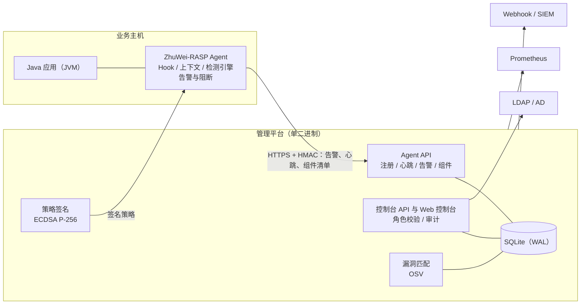

# ZhuWei-RASP

**简体中文** | [English](README.en.md) | [日本語](README.ja.md)

运行时应用自我保护（RASP）平台，由 Java Agent、管理平台与设计文档组成。

| 项目 | 内容 |
|---|---|
| 当前版本 | v0.1.0（MVP） |
| 组成 | Java Agent（JDK 8+）、管理平台（Go 单二进制 + Web 控制台）、设计文档（13 章） |
| 适用阶段 | 概念验证、内部试点；平台部分具备生产部署条件 |
| 上线前提 | 各攻击类型的专用检测算法（见“项目状态”） |

---

## 目录

1. [概述](#概述)
2. [项目状态](#项目状态)
3. [核心能力](#核心能力)
4. [系统架构](#系统架构)
5. [环境要求](#环境要求)
6. [快速开始](#快速开始)
7. [生产部署](#生产部署)
8. [仓库结构](#仓库结构)
9. [开发与测试](#开发与测试)
10. [文档](#文档)
11. [路线图](#路线图)
12. [已知限制](#已知限制)
13. [安全说明](#安全说明)
14. [许可](#许可)

---

## 概述

WAF 部署在应用之外，依据 HTTP 流量判断攻击；RASP 运行在应用进程之内（以 Java Agent 形式注入 JVM），在 SQL 执行、命令执行、文件读写、对外请求、反序列化、JNDI 查找等敏感操作真正执行之前进行检查，判断其参数是否受用户输入控制，并按策略告警或阻断。

由于能够看到完整的执行上下文，RASP 误报更低，也不受流量编码与加密的影响；同时它与业务运行在同一进程中，因此本项目把“Agent 自身稳定、不影响业务”作为最高优先级的设计约束。

## 项目状态

| 范围 | 状态 |
|---|---|
| 管理平台 | 具备生产部署条件：多用户与角色、LDAP/AD 登录、审计、策略签名、限流、健康检查与指标、在线备份、漏洞匹配、部署套件均已实现并通过测试 |
| Java Agent | 适合观察模式试点：接入、Hook、请求上下文、熔断、策略验签、安装卸载已验证；JDK 8/11/17/21 兼容性在 CI 中验证 |
| 检测能力 | 目前仅提供通用规则引擎（“用户输入流入敏感操作”）；各攻击类型的专用检测算法需由安全团队通过 `Detector` 接口实现，这是开启阻断模式前必须完成的工作 |
| 控制台 | 现有页面可用；用户管理、API Token、漏洞列表等能力当前仅提供 API |

建议的上线顺序：

1. 安全团队实现专用检测算法，并用攻防测试集评估（文档第 5、10 章）。
2. 选择非核心应用以观察模式试点至少两周，评估误报与性能影响。
3. 按灰度流程逐个应用开启阻断（文档第 8 章）。
4. 完成[上线检查清单](docs/13-上线检查清单.md)中的全部事项。

## 核心能力

### Java Agent

- **接入方式**：启动参数 `-javaagent`，或对运行中的 JVM 动态 attach / detach，无需重启。
- **隔离设计**：Bootstrap 桩类、独立类加载器、依赖重定位（ASM shade），不与业务依赖冲突。
- **Hook 点**：Servlet 入口（javax / jakarta）、JDBC（按接口匹配任意驱动）、进程创建、文件读写、URL 连接、反序列化、JNDI 查找。
- **请求上下文**：被动采集请求体（JSON / 表单 / multipart，敏感字段脱敏）；上下文可传递到线程池、ForkJoinPool（并行流、CompletableFuture）及新建线程中执行的任务。
- **稳定性**：全路径异常隔离、防重入、按耗时与异常率熔断、`DISABLE` 文件紧急停用、有界队列。
- **组件清单**：识别已加载的第三方 jar（含 Spring Boot 嵌套 jar）及其版本与 SHA-1，变化时上报。

### 管理平台

- 应用、实例、告警、策略、白名单的全生命周期管理；关闭 / 观察 / 阻断三种模式。
- **策略签名**：下发的配置以 ECDSA P-256 签名，Agent 使用固定公钥验签，具备应用绑定与防回滚能力，支持密钥轮换。
- **阻断二次确认**：当策略会使规则开始阻断时，需输入应用名称确认，并记录审计。
- **组件漏洞匹配**：离线导入 OSV 漏洞数据（含 GitHub Advisory Database），按 Maven 版本规则匹配在用组件，给出严重级别与修复版本；新发现的高危漏洞推送 Webhook。
- **告警处置**：研判状态、一键加白、全文检索、CSV 导出、Webhook 通知（企业微信、钉钉、SIEM）。
- **事件聚合**：同一应用、同一攻击类型、同一接口（路径中的数字、UUID 等自动归一）的告警合并为一个事件，按事件研判、批量处置；已修复的事件再次出现时自动重新打开；Webhook 通知按事件聚合，首条立即发送，后续在 5 分钟窗口内汇总。
- **SIEM 对接**：以 syslog（RFC 5424，TCP / TLS / UDP）转发告警与审计日志，载荷可选 JSON 或 CEF。

### 安全与合规

- 三级角色（viewer / operator / admin），所有接口按角色校验，写操作默认至少需要 operator。
- 口令采用 PBKDF2-SHA256；会话与 API Token 仅保存哈希；登录失败按 IP 与用户名锁定。
- 可选 LDAP / Active Directory 登录，按组映射角色，本地账号优先。
- Agent 通信采用 HMAC 签名与防重放；关键操作全部写入审计日志。

### 运维

- 健康检查（`/healthz`、`/readyz`）与 Prometheus 指标（独立内网端口）。
- 按应用的告警限流、在线备份（含签名私钥）、启动安全检查。
- 安装 / 升级 / 卸载脚本，可自动接入 Tomcat、Jetty、WildFly / JBoss、WebLogic、Liberty 与 systemd 服务（传统 WebSphere 提供操作指引）；systemd 单元，Dockerfile，GitHub Actions CI。

## 系统架构



平台不可达时，Agent 继续使用本地缓存策略运行，告警写入本地日志，业务不受影响。

## 环境要求

| 用途 | 要求 |
|---|---|
| 被保护的应用 | JDK 8 及以上；JDK 21+ 动态 attach 会输出 JEP 451 提示，生产环境建议使用 `-javaagent` |
| 构建 Agent | JDK 17+、Maven 3.9+ |
| 构建平台 | Go 1.27+、Node.js 22.12+（仅构建控制台时需要） |
| 运行平台 | 单个二进制文件与一个数据目录；无需数据库服务或 Node.js |

## 快速开始

以下步骤用于评估环境。生产部署请参阅下一节。

**1. 构建**

```bash
./deploy/build.sh
```

产物位于 `dist/`：`dist/rasp/`（Agent 安装目录）、`dist/rasp-server`（管理平台）。

**2. 启动管理平台**

```bash
RASP_ADMIN_PASSWORD='<至少 12 位的口令>' ./dist/rasp-server -listen :8480 -db rasp.db -agent-url http://<平台地址>:8480
```

首次启动时创建管理员账号 `admin`，并在数据库同目录生成策略签名私钥 `rasp-sign.key`（请妥善备份）。

**3. 接入应用**

1. 登录控制台 `http://<平台地址>:8480`，在“应用管理”中新建应用。
2. 将生成的配置保存为 `dist/rasp/conf/rasp.properties`，并把 `dist/rasp` 部署到业务主机的 `/opt/rasp`。
3. 为 Java 应用添加启动参数：`-javaagent:/opt/rasp/rasp-launcher.jar`。新应用默认处于观察模式。

**其他接入与应急方式**

| 场景 | 方法 |
|---|---|
| 不重启接入 | `/opt/rasp/tools/rasp-attach.sh attach <pid> --app <应用名>`；卸载使用 `detach <pid>` |
| 独立模式（无平台） | 不配置 `server.url`，策略取自 `conf/policy.json`，告警写入 `logs/alarm.log` |
| 紧急停用 | 控制台开启全局紧急开关，或在主机上创建文件 `/opt/rasp/DISABLE` |

## 生产部署

| 主题 | 说明 |
|---|---|
| 部署方式 | systemd：`deploy/server/`（含加固配置与每日备份定时器）；容器：`server/Dockerfile`（非 root、distroless） |
| 传输安全 | 使用 `-tls-cert` / `-tls-key` 或前置 TLS 代理；Agent 地址使用 `https://` |
| 账号 | 为每位使用者建立独立账号，或配置 LDAP / AD；集成系统使用 API Token |
| Agent 安装 | `tools/install.sh --properties <配置> --app-user <应用用户> --tomcat <目录>`（或 `--jetty`、`--wildfly`、`--weblogic`、`--liberty`、`--systemd-unit`），支持升级与回滚 |
| 备份 | `rasp-server backup -with-key <文件>`，可在服务运行时执行 |
| 监控 | `RASP_OPS_LISTEN=127.0.0.1:9480` 提供 `/metrics`；告警规则建议见文档第 13 章 |
| SIEM | `-syslog-addr <主机:端口> -syslog-proto tls -syslog-format cef`，转发全部告警与审计日志 |
| 漏洞数据 | 定期执行 `rasp-server import-osv`，或配置 `-osv-url` 自动更新 |

完整的检查项、监控告警建议与实测容量见[上线检查清单](docs/13-上线检查清单.md)。

## 仓库结构

```
agent-java/                 Maven 多模块（Agent 以 Java 8 字节码编译）
  rasp-launcher/            -javaagent 入口、类加载器隔离、attach 工具
  rasp-bootstrap/           注入 Bootstrap 类加载器的桩类
  rasp-core/                Hook、字节码增强、上下文、规则引擎、策略、熔断、上报、组件清单
  demo-app/                 Tomcat 10 演示应用（仅限隔离测试环境）
  compat-app/               Java 8 / Tomcat 9 兼容性测试应用与冒烟测试脚本
server/                     Go 管理平台
  cmd/rasp-server/          主程序与命令行（user / backup / import-osv）
  internal/                 agentapi、console、store、vuln、ldapauth、signing、ops 等
  web/                      Vue 3 + TypeScript 控制台，构建产物内嵌进二进制
deploy/                     构建脚本、Agent 配置模板、安装脚本、systemd 单元
docs/                       设计文档（第 1–13 章）
.github/workflows/          CI：Agent、JDK 兼容性矩阵、平台、浏览器测试、镜像构建
```

## 开发与测试

```bash
(cd agent-java && mvn -B clean package)        # Agent 构建与单元测试
(cd server/web && npm ci && npm run build)     # 控制台类型检查与构建
(cd server && go vet ./... && go test ./...)   # 平台测试
(cd server/web && npm run test:e2e)            # 浏览器端到端测试（启动隔离的平台实例）
./deploy/build.sh                              # 完整构建并组装 dist/
```

约定：

- 默认策略只维护 `deploy/agent-conf/policy.json` 一份，构建时复制到平台。
- 修改 Agent 与平台之间的协议时，同步更新文档第 7 章，并保持新旧版本双向兼容。
- 控制台的设计规范与多语言说明见 [server/web/README.md](server/web/README.md)。

## 文档

设计文档位于 `docs/`，建议先阅读第 1 章了解概念，再阅读第 3、4 章理解架构。设计文档描述目标形态，与当前实现的差异以本文件为准。

| 章节 | 内容 | 主要读者 |
|---|---|---|
| [1 RASP 概述](docs/01-RASP概述.md) | 概念、原理、与 WAF / IAST 的区别、业界方案 | 全员 |
| [2 需求与范围](docs/02-需求与范围.md) | 目标、功能与非功能需求 | 产品、架构 |
| [3 总体架构](docs/03-总体架构.md) | 系统组成、模块划分、技术选型 | 架构、开发 |
| [4 Agent 设计](docs/04-Agent设计-Java.md) | 注入、字节码增强、类隔离、Hook 点、上下文 | Agent 开发 |
| [5 检测引擎与规则](docs/05-检测引擎与规则.md) | 检测算法与规则（待安全团队补充） | 安全研究 |
| [6 管理平台](docs/06-管理平台-Server.md) | 服务、数据模型、权限、接口 | 平台开发 |
| [7 通信协议](docs/07-通信协议与数据模型.md) | Agent 与平台的协议、报文格式 | 全体开发 |
| [8 部署与运维](docs/08-部署与运维.md) | 安装、升级、灰度、备份、密钥管理 | 运维 |
| [9 性能与自身安全](docs/09-性能稳定性与自身安全.md) | 性能预算、熔断、自身防护 | 全体开发 |
| [10 测试方案](docs/10-测试方案.md) | 单元、兼容性、攻防、性能测试 | 测试 |
| [11 开发计划](docs/11-开发计划与里程碑.md) | 阶段、人力、风险 | 管理 |
| [12 参考资料](docs/12-参考资料.md) | 开源项目与规范 | 全员 |
| [13 上线检查清单](docs/13-上线检查清单.md) | 上线前提、部署检查、监控、容量、限制 | 运维、负责人 |

## 路线图

| 优先级 | 事项 |
|---|---|
| P0 | 专用检测算法；观察模式试点与误报治理 |
| P1 | OIDC 单点登录；控制台补齐用户管理、API Token 与漏洞页面 |
| P2 | 内存马检测；WebLogic、WebSphere 等中间件的自动接入 |
| P3 | 基于 ClickHouse / Kafka 的规模化部署；其他语言的 Agent |

## 已知限制

- 检测能力仅为通用规则，尚无各攻击类型的专用算法。
- 单实例平台，数据存储为 SQLite；告警量持续超过每天数千万条时，应迁移到第 3、6 章设计的规模化架构。
- 漏洞匹配仅覆盖带 groupId 与版本号的组件。
- 请求体仅在业务代码读取时采集；重写 `run()` 的 Thread 子类与虚拟线程不传递请求上下文。
- 1–2 个字符的告警关键字搜索为全表扫描。

## 安全说明

- `demo-app` 与 `compat-app` 包含刻意设计的不安全接口，仅可在隔离的测试环境中运行。
- 策略签名私钥 `rasp-sign.key`、数据库文件与 `dist/` 不得提交到代码仓库（已列入 `.gitignore`）。
- 如发现本项目的安全或功能问题，请在issue中披露细节。

## 许可

本仓库目前未声明许可证。对外发布或开放源代码之前，请由项目负责人确定适用的许可证。
